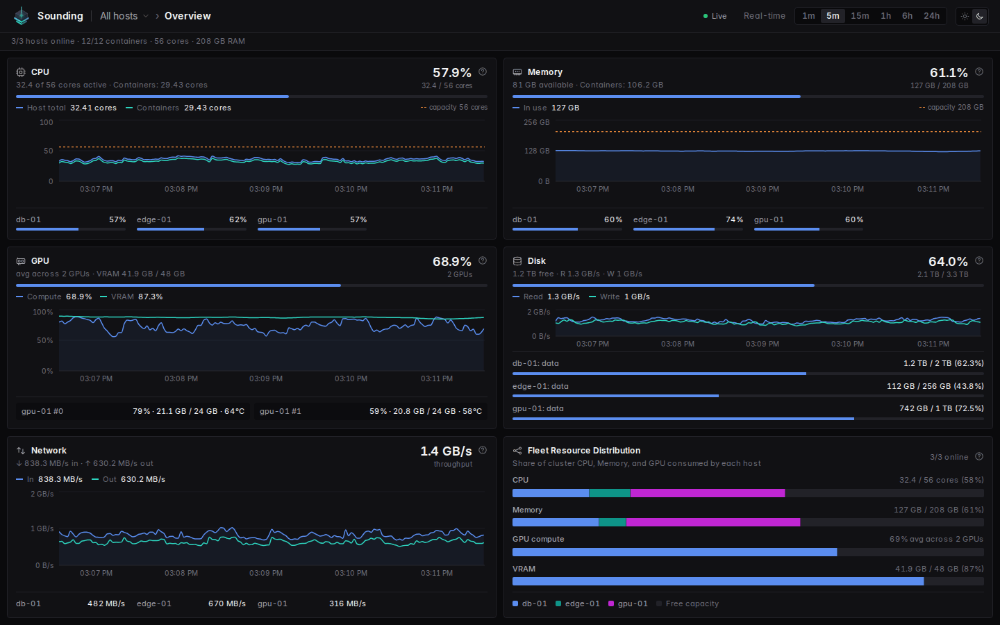
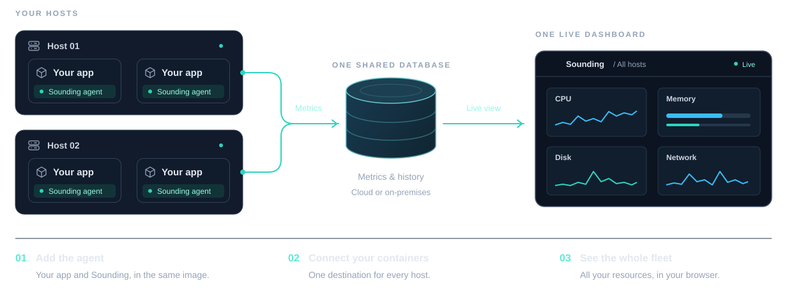

<p align="center"></p>
<h1 align="center">Sounding</h1>

A sounding is how sailors learned what lay beneath the hull: lower a weighted line, or send a ping and
listen for the echo. Sounding brings that same idea to your containers, revealing what's happening
beneath the surface.

**Know what your containers are really doing.** · [Documentation](https://famda.github.io/sounding/)

- See CPU, memory, GPU, disk and network usage against each container's limits.
- Find the processes behind the numbers and see who your containers talk to.
- Bring every container and every host together in one live dashboard.
- No host daemon, sidecars or Docker socket required.



## Getting started

Add Sounding to your images, start the dashboard, and see your containers in one place.

### How it fits together



All you need is Docker Compose v2 and x86-64 Linux containers (Linux or Docker Desktop).
Both images are published to the [famda/sounding](https://hub.docker.com/r/famda/sounding) Docker Hub repository:
`agent-latest` and `dashboard-latest` follow the newest build, and `agent-<commit>` and `dashboard-<commit>` pin one.

### 1. Add Sounding to your container

Copy the agent into your Dockerfile and put `/opt/sounding/run` before your existing entrypoint.
For example, a Redis image becomes:

```dockerfile
FROM redis:8.2
COPY --from=famda/sounding:agent-latest /opt/sounding /opt/sounding
ENTRYPOINT ["/opt/sounding/run", "docker-entrypoint.sh"]
CMD ["redis-server"]
```

Keep your original entrypoint arguments and `CMD`. Your application runs as before, with Sounding alongside it.

### 2. Run the dashboard

Save this as `compose.yaml`, with a `.env` file beside it containing
`SOUNDING_DB_PASSWORD=your-own-strong-password`:

```yaml
services:
  dashboard:
    image: famda/sounding:dashboard-latest
    ports: ["8080:8080"]
    environment:
      SOUNDING_CONNECTION_STRING: "Host=db;Database=sounding;Username=sounding;Password=${SOUNDING_DB_PASSWORD}"
    depends_on:
      db:
        condition: service_healthy
    restart: unless-stopped

  db:
    image: postgres:18-alpine
    environment:
      POSTGRES_DB: sounding
      POSTGRES_USER: sounding
      POSTGRES_PASSWORD: ${SOUNDING_DB_PASSWORD:?set SOUNDING_DB_PASSWORD in .env}
    volumes:
      - db:/var/lib/postgresql
    healthcheck:
      test: ["CMD-SHELL", "pg_isready -U sounding -d sounding"]
      interval: 2s
      timeout: 3s
      retries: 30
    restart: unless-stopped

volumes:
  db:

networks:
  default:
    name: sounding
```

Start it:

```sh
docker compose up -d
```

### 3. Connect your container

Add these settings to your application's Compose service, keeping its other settings and networks:

```yaml
services:
  your-app:
    # Your existing image/build, ports and other settings stay here.
    environment:
      SOUNDING_CONNECTION_STRING: "Host=db;Database=sounding;Username=sounding;Password=${SOUNDING_DB_PASSWORD}"
    networks:
      - sounding

networks:
  sounding:
    name: sounding
    external: true
```

Use the same `.env` file for both Compose stacks, then deploy your updated application as usual.

Open **[http://localhost:8080](http://localhost:8080)**. Your container and its host appear automatically
once the agent connects. Add Sounding to more images to see them in the same dashboard.

> **Already have PostgreSQL?** The included database is optional. Set `SOUNDING_CONNECTION_STRING`
> on the dashboard and agents to reach your own database, in the cloud or on-premises.
> The `sounding` network is only needed for the local setup above.

> Keep the dashboard and database private. The dashboard has no built-in authentication.

## Learn more

- [Documentation site](https://famda.github.io/sounding/) - quickstart, guides, and reference.
- [Upgrade Sounding](https://famda.github.io/sounding/operate/upgrade-sounding/) - image tags and upgrading.
- [Documentation sources](docs/README.md) - the Markdown behind the site, and technical documentation.

## Run the repository samples

Copy `example.env` to `.env`, set `SOUNDING_DB_PASSWORD`, then run `.\platform.ps1 start`.
This builds and starts the dashboard, database and a simulated shop platform (proxy, UI, gateway, APIs, cache and
SQL Server), including ollama on the GPU when the host has an NVIDIA GPU. Open <http://localhost:8080>.
Use `-NoBuild` to reuse built images, or `-Clean` to delete the sample and dashboard volumes before starting.
`.\platform.ps1 stop` stops the solution's containers, including any docs preview, without deleting their volumes
or touching other projects.

## Generate the documentation site

With Docker Compose and PowerShell available, run `.\platform.ps1 docs generate` to regenerate the
screenshots and build the static Next.js documentation site. Node.js and npm run only inside the
build container.
Run `.\platform.ps1 docs start` to preview it locally. See
[the site build instructions](docs/product/site/README.md) for the output directory and publishing details.
