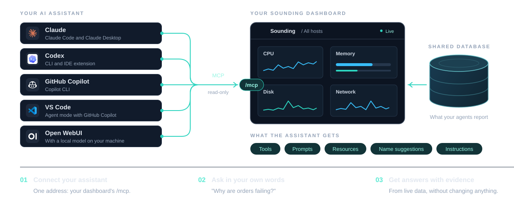

A container keeps restarting. Orders are failing. Several services became slow at once. Start with the question
you would ask a teammate:

> Orders are failing. Find out why, show me the evidence, and tell me what you can't confirm.

With Sounding connected, your assistant can inspect your hosts, containers, processes, network and events instead
of offering a generic troubleshooting checklist. You ask the question; it follows the measurements.



The dashboard includes an [MCP](https://modelcontextprotocol.io) server: there is no extra Sounding service to
install. Use an assistant that supports HTTP MCP connections and can reach the dashboard.

**Choose your starting point:**

- **Already use an assistant?** [Connect it below](#add-sounding-to-your-assistant).
- **Want the model to run on your own machine?** [Set up a local model](set-up-a-local-model.md).
- **Want to see an investigation first?** [Follow a worker from restarts to a memory leak](tutorial-find-a-memory-leak.md).

> [!WARNING]
> The MCP server has no sign-in, like the dashboard. Connect assistants over the same private network you use for
> the dashboard. See [Secure Sounding](../operate/secure-sounding.md).

## Add Sounding to your assistant

Every assistant needs the same two settings:

| Setting | Value |
|---|---|
| Transport | HTTP (also called Streamable HTTP) |
| URL | `http://localhost:8080/mcp`, with your dashboard's address |

Use an address the assistant can reach: `localhost` means the machine running the connection, not necessarily
the machine running Sounding.

### Claude Code

```bash
claude mcp add --transport http sounding http://localhost:8080/mcp
```

Add `--scope user` to use it in all your projects.

### Claude Desktop

Claude Desktop's own connectors can't reach your network, so use a local bridge. With [Node.js](https://nodejs.org)
installed, open **Settings** > **Developer** > **Edit Config**, add this, and restart Claude Desktop:

```json title="claude_desktop_config.json"
{
  "mcpServers": {
    "sounding": {
      "command": "npx",
      "args": ["-y", "mcp-remote", "http://localhost:8080/mcp"]
    }
  }
}
```

For a dashboard on another machine, add `"--allow-http"` to `args`.

### Codex

```bash
codex mcp add sounding --url http://localhost:8080/mcp
```

In the Codex IDE extension: gear menu > **MCP servers** > **Add server** > **Streamable HTTP**.

### VS Code

Run **MCP: Add Server** from the Command Palette, choose **HTTP**, enter the URL, and name it `sounding`.

To share it with your team, add it to your project:

```json title=".vscode/mcp.json"
{
  "servers": {
    "sounding": { "type": "http", "url": "http://localhost:8080/mcp" }
  }
}
```

### GitHub Copilot CLI

```bash
copilot mcp add --transport http sounding http://localhost:8080/mcp
```

### Open WebUI

See [set up a local model](set-up-a-local-model.md).

## Ask a question

Start with "Is anything wrong right now?" and check that your assistant calls a Sounding tool, such as `diagnose`,
before answering. That confirms it is using your monitoring data, not just its general knowledge.

Then try a question that matches what you are seeing:

| You want to… | Ask |
|---|---|
| Follow a failure | "Orders are failing. Check orders-api and follow the services it calls." |
| Investigate restarts | "Why does worker keep restarting? Check its memory and how it last stopped." |
| Look back at an incident | "Orders-api is healthy now, but was slow in the last 30 minutes. What changed?" |
| Find a noisy neighbor | "Several containers on demo-host are slow. Are they competing for resources?" |

Use names as you see them on the dashboard. A unique part is enough: `orders-api` finds `shop-orders-api-1`.
Include when the problem happened; Sounding's default history covers the last 24 hours.

## What a useful answer looks like

Look for a cause supported by measurements, not just a plausible explanation:

- **Evidence:** which container or service, which figures, and at what UTC times?
- **Next action:** what should you inspect or change, and why?
- **Uncertainty:** what could the data not confirm?

If the answer is vague, ask: "Which Sounding results support that conclusion?" A healthy result now does not rule
out an earlier incident, and a container that stopped reporting is not necessarily down.

Sounding's tools only read: none of them changes your containers. An assistant that can also run commands on your
network can still reach the dashboard's [REST API](../reference/api.md), which can start a packet capture.

The assistant receives the data it reads. With a hosted model, that data goes to its provider; choose an assistant
and model appropriate for your monitoring data, or use the [local setup](set-up-a-local-model.md).

## Next steps

- [What Sounding provides](what-sounding-provides.md)
- [Set up a local model](set-up-a-local-model.md)
- [Tutorial: find a memory leak](tutorial-find-a-memory-leak.md)
