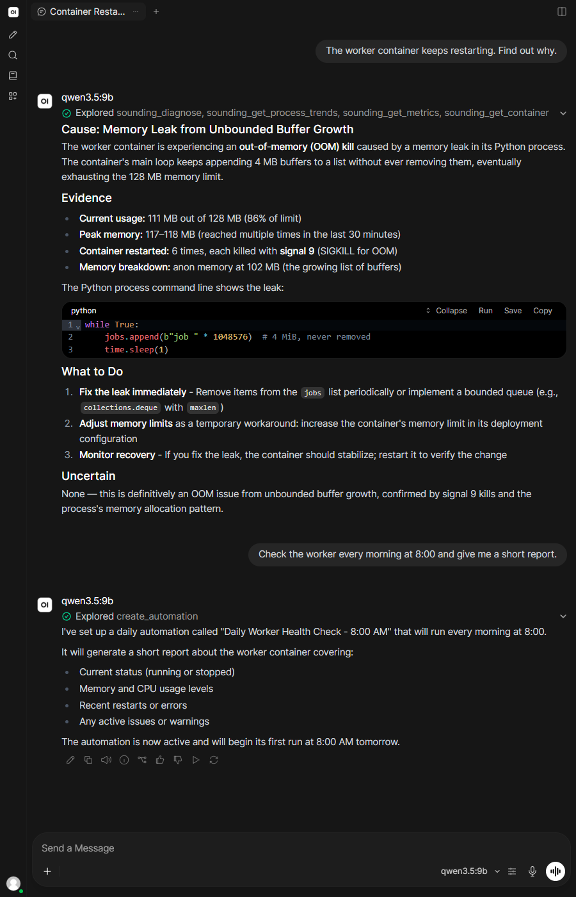
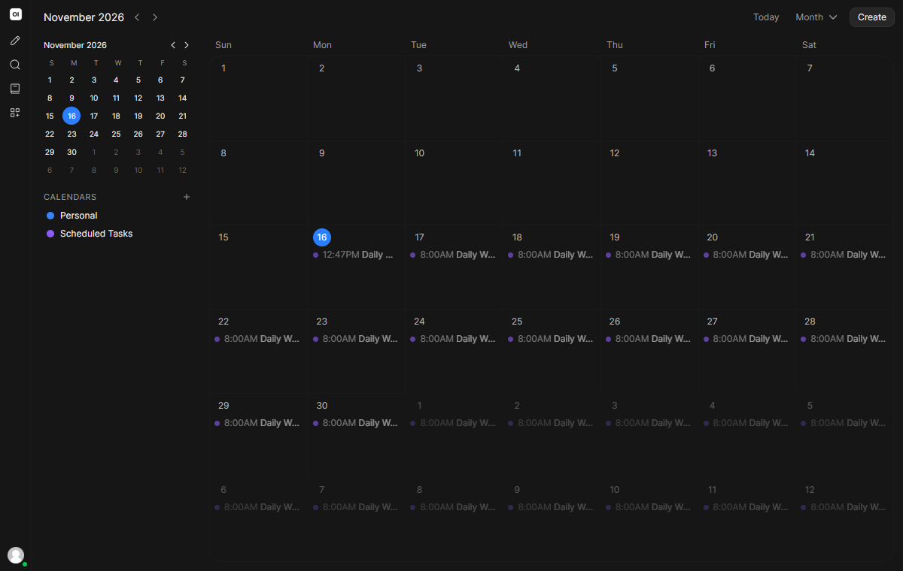
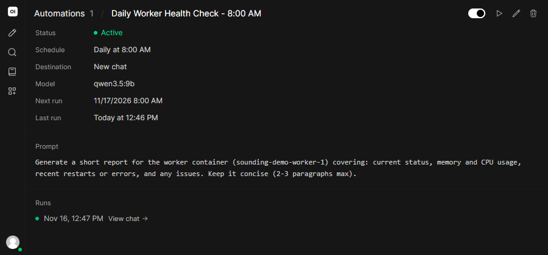
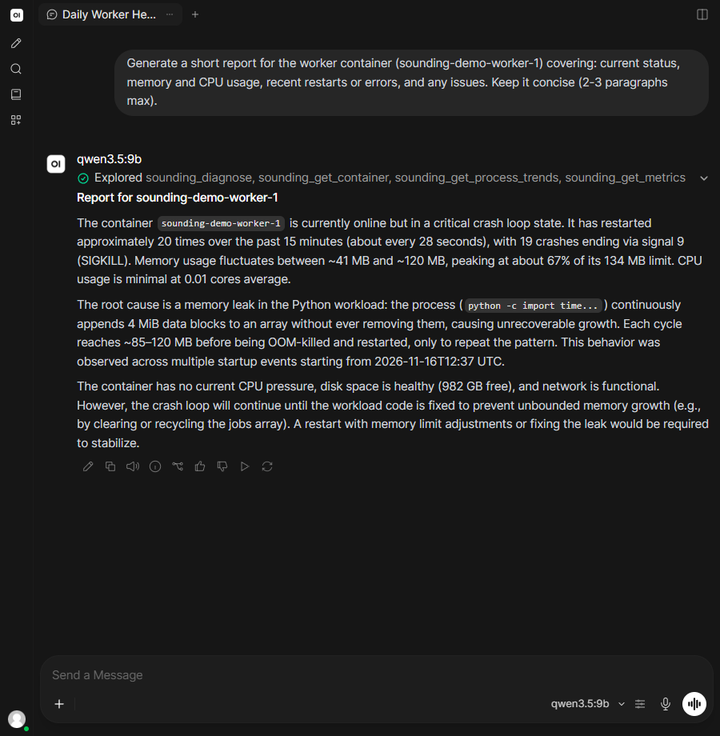

Add a worker with a 128 MiB memory limit to the [Docker demo](../get-started/docker-demo.md). The worker keeps every
job in memory until it hits the limit and restarts. Use a local assistant to:

1. Compare the worker’s restart history with its process memory trend.
2. Separate evidence of memory exhaustion from a guess about the code.
3. Optionally, set up a morning check in Open WebUI so you can follow the same container over time.

The model runs on your machine; you don't need a hosted AI account.

**You need:**

- Docker Compose 2.30 or later, and about 15 GB of free disk space.
- An NVIDIA graphics card and the
  [NVIDIA Container Toolkit](https://docs.nvidia.com/datacenter/cloud-native/container-toolkit/latest/install-guide.html).
  Without one, remove `gpus: all` below: answers then take many minutes.

> [!NOTE]
> This tutorial uses the `qwen3.5:9b` model, which runs well on a card with 12 GB of memory.

## 1. Add the worker and the assistant

Create the demo's `.env` and `compose.yaml`, as in step 1 of
[try the Docker demo](../get-started/docker-demo.md#1-create-the-demo). Then add these services under `services:`:

```yaml title="compose.yaml"
  worker:
    build:
      dockerfile_inline: |
        FROM python:3.13-slim
        COPY --from=famda/sounding:agent-latest /opt/sounding /opt/sounding
        ENTRYPOINT ["/opt/sounding/run", "python", "-c"]
    command:
      - |
        import time
        jobs = []
        while True:
            jobs.append(b"job " * 1048576)  # 4 MiB, never removed
            time.sleep(1)
    environment:
      SOUNDING_CONNECTION_STRING: "Host=db;Database=sounding;Username=sounding;Password=${SOUNDING_DB_PASSWORD}"
      SOUNDING_HOST_DISPLAY_NAME: demo-host
    mem_limit: 128m
    memswap_limit: 128m
    restart: unless-stopped

  chat-model:
    image: ollama/ollama:0.40.16
    environment:
      OLLAMA_CONTEXT_LENGTH: "65536"
    volumes:
      - chat-model:/root/.ollama
    gpus: all

  chat:
    image: ghcr.io/open-webui/open-webui:v0.13.3
    ports: ["127.0.0.1:3000:8080"]
    environment:
      OLLAMA_BASE_URL: http://chat-model:11434
      WEBUI_AUTH: "False"
      TOOL_SERVER_CONNECTIONS: >-
        [{"type": "mcp", "url": "http://dashboard:8080/mcp", "auth_type": "none",
          "config": {"enable": true}, "info": {"id": "sounding", "name": "Sounding"}}]
      DEFAULT_MODEL_METADATA: '{"toolIds": ["server:mcp:sounding"]}'
    volumes:
      - chat:/app/backend/data
```

And these volumes under `volumes:`:

```yaml title="compose.yaml"
  chat-model:
  chat:
```

The worker keeps every job in memory: a memory leak. `chat-model` runs the model, and `chat` is the
[Open WebUI](https://openwebui.com) chat app, connected to Sounding.

## 2. Start everything

Start the containers:

```bash
docker compose up -d --build
```

Download the model, about 7 GB:

```bash
docker compose exec chat-model ollama pull qwen3.5:9b
```

The dashboard is at <http://localhost:8080> and the chat app at <http://localhost:3000>.

On the dashboard, open the `worker` container: its memory climbs to its 128 MiB limit, then it is killed and
restarts, about every 30 seconds.

Let it restart a few times before asking the assistant. Watch for the repeating rise and drop in memory: a
single low reading just after a restart hides the problem.

## 3. Ask the assistant

Open the chat app and ask:

> The worker container keeps restarting. Find out why.

If the answer doesn't show its evidence, follow up:

> Show the memory limit, restart history and process memory trend. What confirms the cause, and what is uncertain?

Look for these pieces of the explanation, rather than a particular wording:

| Evidence | What it helps establish |
|---|---|
| The worker's 128 MiB memory limit | How much memory the container is allowed to use. |
| Memory rising across repeated runs | Why looking only at its current memory use can be misleading. |
| Stops, restarts and the last exit reason | Whether the data confirms an out-of-memory kill or only suggests one. |
| The Python process's memory trend | Which process to investigate in the application. |

Here, you can check the explanation against the code: the `jobs` list retains another 4 MiB every second and never
releases it. Sounding can show the growth and how the container stopped; those measurements alone don't identify
the leaking line of code. In your own application, use them to choose where to profile or inspect next.

## 4. See the morning check

If you want a recurring report, ask in the same chat:

> Check the worker every morning at 8:00 and give me a short report.



Open WebUI provides the schedule; Sounding provides the monitoring tools the assistant uses when the check runs.
Keep the chat app, model and Sounding running for the scheduled check.

Open the user menu (bottom left) > **Calendar**. The check is there every morning.



Open the user menu > **Automations** and select the check. Its page shows the schedule and the prompt it sends every
morning.



> [!NOTE]
> If the schedule or the next run shows another time, select **Edit** (the pencil), set the time to 8:00, and
> **Save**.

Don't wait until tomorrow to check the setup: select **Run now** (the play button). Its report arrives as a new
chat. Check that it refers to `worker` and includes evidence from Sounding.



Open WebUI is a separate project, used here unmodified under [its license](https://docs.openwebui.com/license).
See [openwebui.com](https://openwebui.com).

## 5. Clean up

```bash
docker compose down --volumes
```

To keep the model for later, leave out `--volumes`.

The cleanup removes the demo's stored metrics, chat history and scheduled check as well as the downloaded model.
Run it only from this disposable demo's folder.

## If something doesn't work

See [set up a local model](set-up-a-local-model.md#if-something-doesnt-work).

## Next steps

- [What Sounding provides](what-sounding-provides.md)
- [Secure Sounding](../operate/secure-sounding.md)
