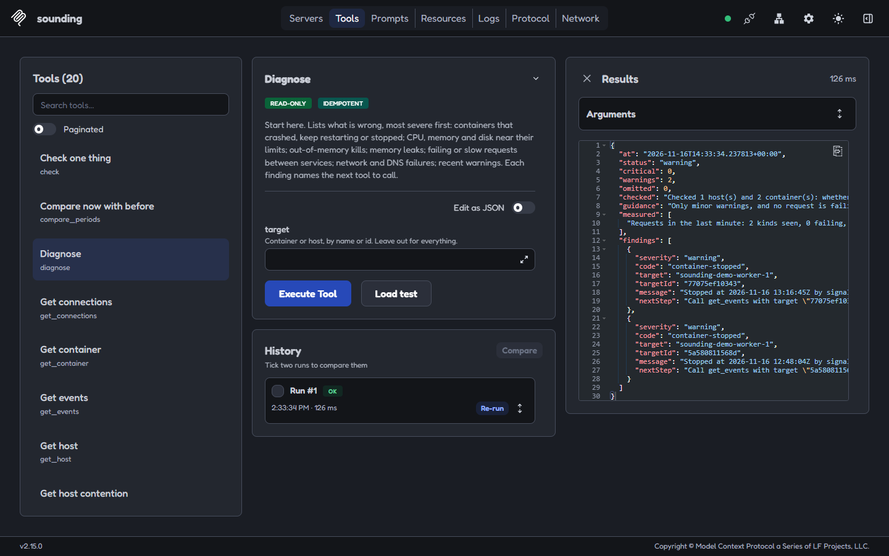
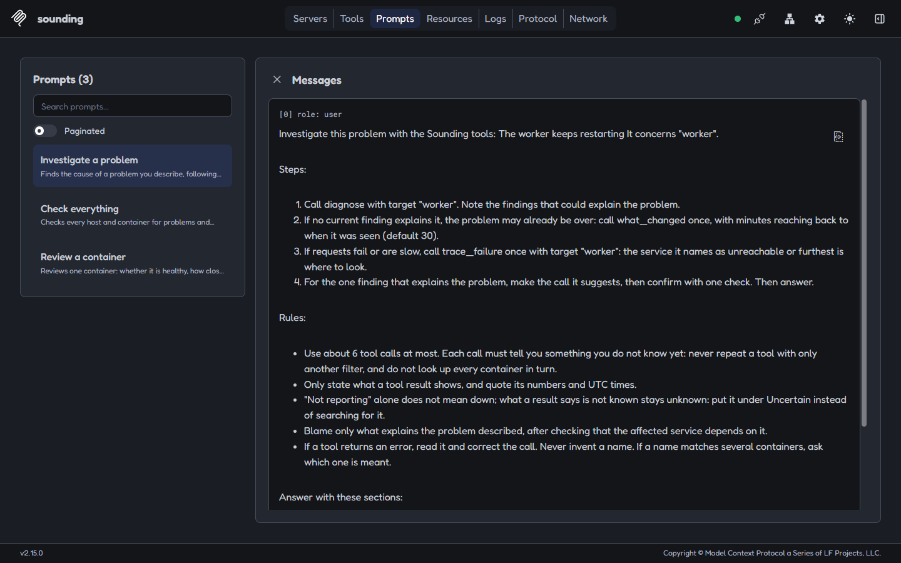

You don't need to know a tool name to ask why a service is failing. Sounding gives your assistant ways to find
problems, follow them to the affected service, and check an explanation against measurements. The assistant
does the reasoning; Sounding supplies the evidence.

## From question to evidence

For a question such as "Why does worker keep restarting?", an investigation can follow this path:

1. **Find the symptom.** `diagnose` reports the restarts, how the container stopped, and a suggested next lookup.
2. **Look for an explanation.** `get_process_trends` shows which process uses memory and whether it is growing.
3. **Check the conclusion.** `check` can ask whether the container was killed for running out of memory. It returns
   the evidence, including when the cause is only likely or cannot be determined.

The path depends on the findings: failing requests call for a dependency trace, not a memory investigation.
[Try the memory leak tutorial](tutorial-find-a-memory-leak.md) to see a complete example.

## What your assistant receives

| Feature | What it is | Supported by |
|---|---|---|
| [Tools](#tools) | Lookups the assistant runs to answer your questions. | Every MCP assistant |
| [Instructions](#instructions) | A short guide to investigating, sent when the assistant connects. | Most assistants |
| [Prompts](#prompts) | Ready-made investigations you start yourself. | Some assistants, such as Claude Desktop and VS Code |
| [Resources](#resources) | Reference material you can attach to a conversation. | Some assistants |

Without prompts or resources, an assistant still does everything with the tools: just ask in your own words.

## Tools

Ask in your own words and your assistant can run the lookups below. Each tool reads monitoring data. Your assistant
may ask your permission before using one.

**Find what's wrong**

| Tool | What it answers |
|---|---|
| `diagnose` | What's wrong now, most serious first, and what to look at next. |
| `trace_failure` | Which service, along a chain of calls, causes a failure. |
| `what_changed` | What changed recently, including problems that are already over. |
| `check` | Yes, no, or unknown to one question, such as "is its memory growing?", with the evidence. |

**Look closer**

| Tool | What it answers |
|---|---|
| `get_timeline` | What happened to a container or host, in order. |
| `compare_periods` | What is different now from before. |
| `get_host_contention` | Whether a machine is short of CPU, memory or disk, and who takes most. |
| `get_dependencies` | Which services call which, and how many calls fail. |
| `get_events` | Restarts, stops, out-of-memory kills, new ports and destinations. |

**Read the figures**

| Tool | What it answers |
|---|---|
| `list_hosts`, `get_host` | Your machines and their latest figures. |
| `list_containers`, `get_container` | Your containers, or everything about one of them. |
| `get_metrics` | How a container or host behaved over a period. |
| `get_process_trends`, `get_processes` | The busiest processes, those whose memory grows, or what ran at a given time. |
| `get_network`, `get_connections` | Open ports, who a container talks to, and connections with problems. |
| `get_logs` | A container's most recent output. |
| `get_storage` | What fills a container's disk, and when it will be full. |

Tools that look at one container or host take a `target`: its name as you see it on the dashboard. A name that
matches several containers is an error, so the assistant asks you which one you mean.

## Instructions

Sounding tells a connecting assistant how to investigate: start with `diagnose`, follow a failure to the service
behind it, quote numbers and UTC times, and stop once there is enough evidence to answer. Its guidance aims for
three to five lookups, not an exhaustive tour of every container.

Sounding reports facts, and says what it doesn't know:

- **Not reporting isn't down.** A container whose agent went silent may still be running. Sounding calls it
  unreachable only when its callers' requests fail.
- **Healthy means now.** `diagnose` checks current problems with the last 15 minutes of events for context.
  Look for problems that are already over in `what_changed`, `get_timeline` and `get_events`.
- **Busy isn't broken.** Full GPU memory or a short CPU burst is a problem only once something fails or slows down.
- **Partial answers say so.** An answer that couldn't look at everything says what it left out.

## Prompts

Prompts start an investigation for you. The assistant answers with the cause, the evidence, the impact, what to do,
and what remains uncertain.

| Prompt | Use it to | You fill in |
|---|---|---|
| `investigate` | Find the cause of a problem you describe. | The problem, and optionally the container and when it started. |
| `check_health` | Check everything and explain the most important problems. | Nothing. |
| `review_container` | Check one container's health, limits and dependencies. | The container. |

While you fill in a prompt, your assistant suggests your container and host names.

## Resources

| Resource | What it contains |
|---|---|
| Metrics reference | What each figure means, and which values point to a problem. |
| Events reference | What each event means. |
| Host, Container | The latest figures of one host or container. |

## Explore it in the MCP Inspector

To see everything on this page for yourself, open Sounding in the
[MCP Inspector](https://github.com/modelcontextprotocol/inspector), a separate project from the Model Context
Protocol: you browse the tools, prompts and resources, and run them by hand.

Add it to the `compose.yaml` that runs the dashboard (Docker Compose 2.23 or later):

```yaml title="compose.yaml"
services:
  # ...your existing services, including dashboard...

  mcp-inspector:
    image: ghcr.io/modelcontextprotocol/inspector:2.15.0
    ports: ["127.0.0.1:6274:6274"]
    environment:
      DANGEROUSLY_BIND_ALL_INTERFACES: "true"
      MCP_INSPECTOR_SECRET_STORE: memory
      MCP_CATALOG_PATH: /catalog/mcp.json
    configs:
      - source: mcp-catalog
        target: /catalog/mcp.json

configs:
  mcp-catalog:
    content: |
      {"mcpServers": {"sounding": {"type": "streamable-http", "url": "http://dashboard:8080/mcp"}}}
```

Start it:

```bash
docker compose up -d mcp-inspector
```

Open <http://localhost:6274> and switch **sounding** on. Then open **Tools**, select one, and select
**Execute Tool**:



**Prompts** shows the plan each prompt gives the assistant:



## Next steps

- [Set up a local model](set-up-a-local-model.md)
- [Tutorial: find a memory leak](tutorial-find-a-memory-leak.md)
