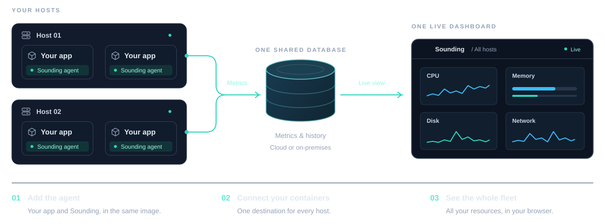

Sounding has three parts: an **agent** in each container you monitor, one **database** they all report to, and the
**dashboard** you open in your browser.

## The agent

The agent is part of your container image. A small launcher starts your application and the agent side by side. It
keeps your application's user and command, and passes through its signals, exit code, and output. Sounding adds an
agent inside the container, so its resource use counts toward that container.

By default, the agent measures its container (CPU, memory, disk, network, processes, and GPU use) once a second and
writes the figures to the database. It also notices events, such as a process being killed for lack of memory or a new
port opening.

The agent sees the machine it runs on, too. Agents coordinate so one container reports the host's core figures.
Network, disk-space, and GPU reporting each have their own role, held by one container with the necessary access;
these can be different containers. When an agent's database session ends, another eligible agent can take its roles
on its next sampling tick. Rates need fresh samples, so takeover isn't guaranteed within one second.

If the agent can't run or reach the database, your application keeps running. Only the monitoring stops.

## The database

All agents and the dashboard use one PostgreSQL database that you provide. The default retention target is 24 hours;
running host-sampling agents periodically delete older data. The dashboard alone doesn't perform this cleanup.
The database is the only destination for collected metrics.

See [set up the database](../operate/set-up-the-database.md).

## The dashboard

The dashboard reads the database and pushes updates to your browser as they arrive. With the default one-second
sampling interval, figures are usually about a second old. It stores nothing itself: you can restart it, or run several,
without losing anything.

## What Sounding sees, and what it doesn't

- It sees **the containers that have the agent**, not the other containers on the machine. Machine-wide figures, such as
  the host's CPU, include everything running on it.
- It reads **what Linux reports to a container**. Some figures need more access than a container has by default, such
  as the host's network interfaces or other users' processes. The dashboard shows **Not available** where it can't
  read something. See [show the host's network, disks, and GPUs](../operate/show-host-network-disk-and-gpu.md) and
  [allow packet inspection and process details](../operate/allow-packet-inspection-and-process-details.md).
- It can look at **network traffic**: who a container talks to and the requests it makes. Some of that information can
  be sensitive. See [secure Sounding](../operate/secure-sounding.md).

## Next steps

- [Hosts, containers, and the fleet](hosts-and-containers.md)
- [Samples and history](samples-and-history.md)
