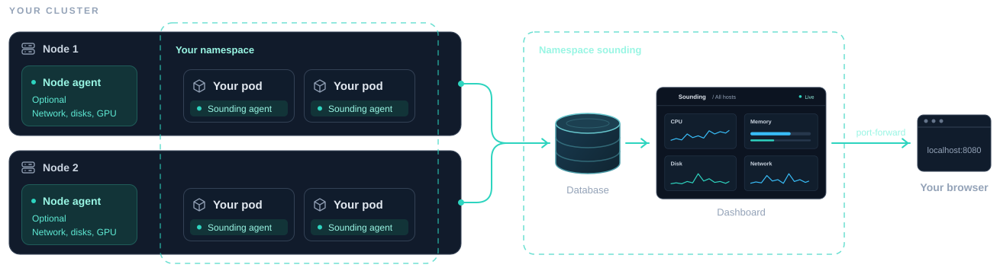

Sounding shows your containers' resource use, processes, and network activity, grouped by node. An agent runs inside
each container you monitor and sends its figures to PostgreSQL. You can also add a node agent for the node's network,
disks, and GPUs.

## The parts

- **The agent runs inside your application's container**, not beside it as a sidecar: it reads that container's
  resource limits and starts your application. You build it into the image, or copy it in when the pod starts for
  images you don't build.
- **The node agent is a pod of its own** on each node, in its own namespace. Reading the node's network, disks, and
  GPUs needs the node's `/proc`, `/sys`, and disk; keeping that in one pod means your application pods never get that
  access. Without it, a host's network and GPUs show **Not available**, and its disks are limited to the one your
  containers run from.

[Set up Sounding on Kubernetes](../deployment/kubernetes.md) deploys each part.

## Hosts and containers

| Sounding shows | Kubernetes | Example |
|---|---|---|
| A **host** | A node | `worker-1` |
| A **container's name** | `namespace/workload`, and `/container` when it isn't named after the workload | `shop/web` |
| A **container's identity** | The pod's UID and the container's name | `0f3c…e81a/web` |

The agent takes these from settings the manifest passes it: the node's name and the pod's namespace, name, and UID
from the Downward API, and the container's name. See
[configure the agents](../deployment/kubernetes.md#3-configure-the-agents-and-deploy).

- **The workload's name** is worked out from the pod's name: `web-7c9d8b6f4-x2kqp` is `web`, and `db-0` is `db`. It's
  a guess from the name's shape, so a bare pod named like one of these is shortened too. Set `SOUNDING_DISPLAY_NAME`
  to choose the name yourself. Each replica appears separately under the same name.
- **A container that restarts in its pod** keeps its identity and its history.
- **A rollout replaces pods.** When Kubernetes replaces `db-0`, the new pod has a new UID. Its container starts
  a separate history even though the name stays the same. The old samples remain available within the history
  window. The old container shows **Stopped** if its agent recorded the stop, or **Not reporting** if it disappeared
  abruptly, for example when its node went away.
- **Missing settings.** Without them, the agent reads the pod's UID and container name from the pod's files, and the
  namespace from its service account; it records an `identity` warning event. If it can't find the UID or container
  name either, each run of the container is a new container, and its history doesn't carry over a restart.

Node names, pod names, and addresses are only unique within a cluster. Sounding doesn't tell clusters apart: give each
cluster its own database, or make sure their node names and address ranges don't overlap.

## Calls between services

Your containers call each other through Services. A Service's address belongs to no container, and Kubernetes chooses
the pods behind it by label, not by name, so Sounding doesn't guess which container answered a call from the
Service's name. You see two kinds of link:

- **The caller's view:** `shop/client → web.shop.svc`. It's named after the Service, as `<service>.<namespace>.svc`,
  and holds every request the caller saw, including the ones that failed before reaching any pod.
- **Each server's view:** `shop/client → shop/web`, from each `shop/web` replica that answered, with the requests and
  traffic it received.

These describe the same calls, seen from each end, so don't add them up. A call made straight to a pod's address
shows once.

For this, Sounding needs your cluster's pod and Service address ranges, set with `SOUNDING_CLUSTER_NETWORKS`. They
also let it match calls to pods on other nodes.

## What Sounding doesn't see

| On Kubernetes | Sounding | Use instead |
|---|---|---|
| Kubernetes events: `CrashLoopBackOff`, evictions, failed probes | Shows the restarts and exits, not the reason Kubernetes gives. | `kubectl describe pod` |
| A container killed for using too much memory | Records a restart without warning when the container starts again, with its memory at its last sample. It can't tell an out-of-memory kill from a forced one. | `kubectl describe pod`: **OOMKilled** |
| Which pods a Service sends calls to | Shows the Service as the caller saw it, and each monitored server's side separately. | `kubectl get endpointslices` |
| Namespaces with the **restricted** Pod Security Standard | No requests, DNS lookups, or packet captures; connections and traffic totals remain. | See [Pod Security Standards](../deployment/kubernetes.md#pod-security-standards). |
| NodePort and LoadBalancer Services | Not shown as published ports. | `kubectl get services` |

## Next steps

- [Try the Kubernetes demo](../get-started/kubernetes-demo.md)
- [Set up Sounding on Kubernetes](../deployment/kubernetes.md)
