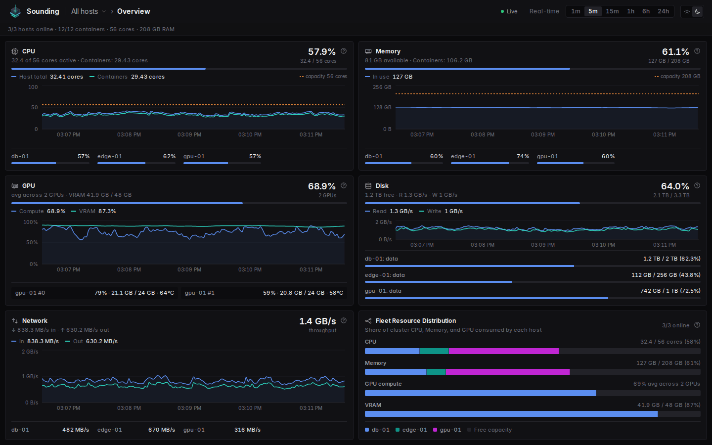

The dashboard is built for moving from a broad view to the cause: start with all your hosts, open the one that needs
attention, then a container, then the process behind it.

## Choose what to look at

The header shows where you are, for example **All hosts › db-01 › postgres-1**. Select any part to go back to it.

To go somewhere else, select the last part of the header, or press **/**. The picker lists every host and its
containers with their current figures; type to filter it. Press **Esc** to close it.

On an overview, you can also select a host or a container in the bar charts to open it.

## Open a page

A host or container opens on its **overview**: six tiles with its CPU, memory, GPU, disk, and network, and who uses
them. Select a tile, or choose a page from the menu in the header:

| Page | Open it when you want to know |
|---|---|
| **CPU** | Why something is slow: a limit, competition for the processor, or a busy process. |
| **Memory** | How close memory is to its limit, whether it's growing, and whether anything was killed. |
| **GPU** | How busy the NVIDIA cards are, and which programs use them. |
| **Disk** | Whether the disk is slow or full, and what is filling it. |
| **Network** | Who a container talks to, its requests, open ports, and network errors. |
| **Events** | What happened, and what the containers printed. |

## Read a chart

- **Choose the time range** in the header: **1m**, **5m**, **15m**, **1h**, **6h**, or **24h**.
- **Hover** over a chart to see its values at that moment. Every chart on the page follows the same moment, and the
  process tables show the processes at that time.
- **A dashed line** is a limit or the capacity, when there is one.
- **Select ?** next to a chart to see what it shows and what each line means.

## Use the tables

- **Sort** by selecting a column header; select it again to reverse the order.
- **Resize** a column by dragging the edge of its header; double-click the edge to reset it.
- **Expand** a table with **Use the whole page**; press **Esc** to go back.
- **Hide Sounding** hides Sounding's own processes and traffic from every table, so you only see your application's.
  Sounding's resource use still counts in the charts.

## Connection status

The header shows whether the dashboard is up to date:

| Status | Meaning |
|---|---|
| **Live** | Figures are arriving. |
| **Connecting** or **Reconnecting** | The browser is connecting to the dashboard. |
| **Stale data** | No new figures for more than 10 seconds. The last figures stay on screen. See [troubleshooting](../troubleshooting/troubleshoot.md#the-dashboard-shows-stale-data-or-reconnecting). |

## Next steps

- [Investigate a CPU slowdown](investigate-cpu.md)
- [Investigate memory problems](investigate-memory.md)
- [Metrics glossary](../reference/metrics.md)
