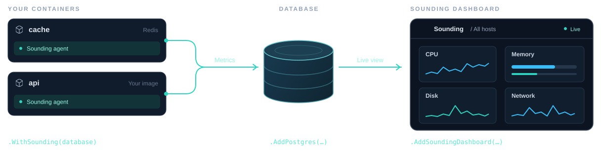

The `Sounding.Aspire.Hosting` package adds Sounding to an [Aspire](https://aspire.dev) AppHost. You add the Sounding
dashboard and its database as resources, and add the agent to each container you want to monitor. When the AppHost
runs, those containers appear in Sounding with their CPU, memory, disk, network and GPU figures, measured against
their limits.

**Just exploring?** The [Sounding Aspire samples](https://github.com/famda/sounding-aspire/tree/main/src/samples)
include a small shop to run on your machine, and Sounding's Compose and Kubernetes demos to deploy.

## How it fits your AppHost

Sounding has three parts: an agent inside each container you monitor, a PostgreSQL database the agents report to,
and a dashboard that reads that database. The agent measures most figures every second, and the dashboard shows them
as they arrive.



Each part of Sounding becomes a resource in your AppHost: `WithSounding` adds the agent to a container resource, a
PostgreSQL resource holds the database, and `AddSoundingDashboard` adds the dashboard. See
[how Sounding works](../concepts/how-sounding-works.md).

**You need:**

- An AppHost on Aspire 17 or later, on .NET 10 or later.
- Docker, with x86-64 or ARM64 Linux containers. See [requirements](../get-started/getting-started.md#requirements).

## 1. Add the package

Add the package to your AppHost project:

```sh
dotnet add package Sounding.Aspire.Hosting
```

For a single-file AppHost, add this directive at the top of `apphost.cs` instead:

```csharp title="apphost.cs"
#:package Sounding.Aspire.Hosting@1.0.0
```

## 2. Add Sounding to your AppHost

Add a PostgreSQL database and the Sounding dashboard, then call `WithSounding` on each container you want to monitor.
The database uses Aspire's PostgreSQL integration, from the `Aspire.Hosting.PostgreSQL` package:

```csharp title="AppHost.cs"
var builder = DistributedApplication.CreateBuilder(args)

var database = builder.AddPostgres("postgres")
    .WithDataVolume()
    .AddDatabase("sounding-db");

builder.AddSoundingDashboard("sounding", database);

builder.AddRedis("cache")
    .WithSounding(database);

builder.AddOllama("ollama")
    .WithGPUSupport(OllamaGpuVendor.Nvidia)
    .WithSounding(database);

builder.Build().Run();
```

The `ollama` container uses the Community Toolkit's Ollama integration, from the
`CommunityToolkit.Aspire.Hosting.Ollama` package, and gets the NVIDIA GPU. Sounding shows the GPU on the host, and
how much of it the container uses while a model runs. Leave it out if your machine has no NVIDIA GPU. See
[monitor GPUs](../dashboard/monitor-gpus.md).

`WithSounding` builds a copy of the container's image with the agent added. The copy starts the agent, which starts
the image's original command, so your application runs as before: same user, arguments, signals and logs. If you set
the container's entrypoint with `WithEntrypoint`, call it before `WithSounding`.

> [!WARNING]
> `WithSounding` works only on container resources: those from `AddContainer` and `AddDockerfile`, and from
> integrations such as `AddRedis` or `AddPostgres`. It doesn't work on .NET projects added with `AddProject`, which
> run as processes rather than containers. To monitor a .NET project, build it with a `Dockerfile` and add it with
> `AddDockerfile`, as in [images you build](#images-you-build).

## 3. Run the AppHost and open Sounding

Start the AppHost:

```sh
aspire run
```

In the Aspire dashboard, wait until the **sounding** resource is **Healthy**, then open its URL.

**Check that it is working:**

1. Select your host. On Docker Desktop, the host is Docker's Linux virtual machine, not your Windows or macOS machine.
2. Find your container, named after its resource, such as **cache**, and look for live CPU and memory figures.
3. Check that the header says **Live**. Wait a few seconds for the charts to build up.

If your container doesn't appear, start with
[My container doesn't appear](../troubleshooting/troubleshoot.md#my-container-doesnt-appear).

### Make your first check

Use the application as you normally would: send a request or run a small job. Open the container's **CPU** or
**Memory** page, choose **1m**, and hover over the chart to see its figures at that moment.

You now have a starting point for a real question: is memory growing, is the container reaching a CPU limit, or
which process is busy? [Find your way around the dashboard](../dashboard/find-your-way-around.md) explains how to
follow those clues.

> [!TIP]
> To ask an AI assistant about what Sounding shows, connect it to the dashboard's MCP server. In the AppHost, the
> dashboard resource's `McpUrlExpression` holds its address. See
> [connect an AI assistant](../ai-assistants/connect-an-ai-assistant.md).

## Images you build

`WithSounding` doesn't rebuild an image that comes from your own `Dockerfile`. Add the agent in the `Dockerfile`
instead: copy it into the image, and start your application through the agent's launcher, as described in
[add the agent to your image](docker-compose.md#1-add-the-agent-to-your-image). Then call `WithSounding` on the
resource to connect the agent to the database.

```dockerfile title="Dockerfile"
COPY --from=famda/sounding:agent-latest /opt/sounding /opt/sounding
ENTRYPOINT ["/opt/sounding/run", "dotnet", "MyApp.dll"]
```

## Control host access

By default, `WithSounding` gives the agent read-only access to the host's `/proc`, so Sounding can show the host's
network interfaces, traffic and connections. To turn this off for a container, pass `hostAccess: false`. Sounding
still reports the container's own figures.

```csharp title="AppHost.cs"
builder.AddContainer("worker", "my-registry/worker", "1.4")
    .WithSounding(database, hostAccess: false);
```

To show details of processes that run as another user in the container, pass `processDetails: true`. This grants the
container the `SYS_PTRACE` capability, so grant it only where you need it. See
[what needs extra access](../get-started/getting-started.md#optional-access).

## Deploy

The agents and the dashboard are part of your AppHost, so they're deployed with it. To deploy, add an environment
for your target to the AppHost, then deploy with the Aspire CLI.

### Docker Compose

Add the Docker integration to your AppHost:

```sh
aspire add docker
```

Then add a Docker Compose environment:

```csharp title="AppHost.cs"
builder.AddDockerComposeEnvironment("env");
```

Each container keeps its agent, and the host's `/proc` is mounted read-only.

### Kubernetes

Add the Kubernetes integration to your AppHost:

```sh
aspire add kubernetes
```

Then add a Kubernetes environment:

```csharp title="AppHost.cs"
builder.AddKubernetesEnvironment("k8s");
```

Each container keeps its agent and its host access. Sounding also reads each pod's node and identity, and names the
container `namespace/workload`.

Aspire deploys to Kubernetes with Helm, and pushes the images it builds, so you need Helm and a container registry
that your cluster pulls from. Host access uses a host path, which the baseline and restricted
[Pod Security Standards](kubernetes.md#pod-security-standards) don't allow: in those namespaces, pass
`hostAccess: false`.

### Azure Container Apps

Containers keep their agent but get no host access, because the platform doesn't expose the host. Sounding shows each
container, but not its host's network.

### Deploy and remove

```sh
aspire publish   # writes the deployment files without deploying
aspire deploy    # builds the images and deploys
aspire destroy   # removes the deployment
```

Deploying rebuilds each image with the agent, so the machine you deploy from needs Docker.

> [!WARNING]
> The dashboard has no sign-in. Before others can reach a deployed dashboard, put it behind your own authentication.
> See [secure Sounding](../operate/secure-sounding.md).

## Next steps

- [Find your way around the dashboard](../dashboard/find-your-way-around.md)
- [Monitor containers and hosts](../get-started/monitor-containers-and-hosts.md)
- [Connect an AI assistant](../ai-assistants/connect-an-ai-assistant.md)
- [The package on NuGet](https://www.nuget.org/packages/Sounding.Aspire.Hosting) and
  [its source](https://github.com/famda/sounding-aspire)
