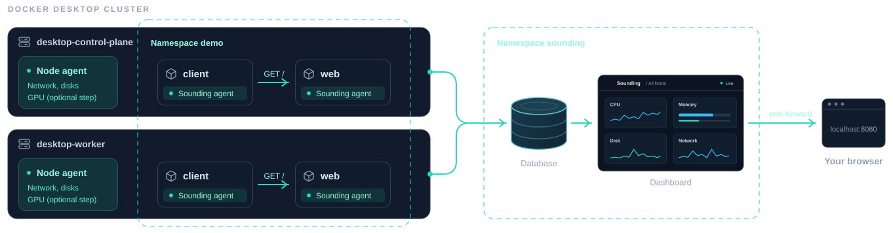

Run two web servers and two clients on Docker Desktop's Kubernetes cluster, then find them in Sounding. Scale the web
servers and roll out new clients to see how replicas and their history appear in the dashboard.



**You need:**

- **Docker Desktop** on an **x86-64** or **ARM64** computer (including Apple silicon Macs), with **Kubernetes** turned
  on (step 1).
- `kubectl`, which Docker Desktop installs.
- A shell: **bash** with `openssl` and `unzip` (macOS, Linux), or **PowerShell** (Windows PowerShell 5.1 or
  PowerShell 7). Where the commands differ, choose yours above the commands.

It takes about 15 minutes, plus the time Docker Desktop takes to create the cluster and download the images.

## 1. Turn on Kubernetes

In Docker Desktop, open **Settings › Kubernetes**, select **Enable Kubernetes**, choose a **kind** cluster with
**2 nodes**, and select **Apply**. When it's running, check the nodes:

```shell
kubectl get nodes
```

```output
NAME                    STATUS   ROLES           AGE   VERSION
desktop-control-plane   Ready    control-plane   1m    v1.36.4
desktop-worker          Ready    <none>          1m    v1.36.4
```

## 2. Get the sample



Unzip it and open the folder:



```sh
unzip sounding-kubernetes.zip
cd sounding-kubernetes
```

```powershell
Expand-Archive sounding-kubernetes.zip .
cd sounding-kubernetes
```



Run the next commands from this folder. The same files are in `samples/kubernetes` in
[Sounding's repository](https://github.com/famda/sounding).

## 3. Create the namespaces and secrets

The sample uses three namespaces: `sounding` for Sounding, `sounding-node` for the node agents, and `demo` for the app.
Create them with a random database password, and a connection string for the agents in each:



```sh
password=$(openssl rand -hex 16)
connection="Host=db.sounding.svc.cluster.local;Database=sounding;Username=sounding;Password=$password"
for ns in sounding sounding-node demo; do
  kubectl create namespace $ns --save-config
  kubectl -n $ns create secret generic sounding-agent --from-literal=SOUNDING_CONNECTION_STRING="$connection"
done
kubectl -n sounding create secret generic sounding-db --from-literal=password=$password
```

```powershell
$bytes = New-Object byte[] 16
[Security.Cryptography.RandomNumberGenerator]::Create().GetBytes($bytes)
$password = -join ($bytes | ForEach-Object { $_.ToString('x2') })
$connection = "Host=db.sounding.svc.cluster.local;Database=sounding;Username=sounding;Password=$password"
foreach ($ns in 'sounding', 'sounding-node', 'demo') {
  kubectl create namespace $ns --save-config
  kubectl -n $ns create secret generic sounding-agent --from-literal=SOUNDING_CONNECTION_STRING="$connection"
}
kubectl -n sounding create secret generic sounding-db --from-literal=password=$password
```



## 4. Build the demo's images

Each image has the agent built in: see `web/Dockerfile`.

```shell
docker build -t sounding-demo/web:1 web
docker build -t sounding-demo/client:1 client
```

Docker Desktop's cluster doesn't see images you build, so copy them onto each node:

```shell
docker save -o demo-images.tar sounding-demo/web:1 sounding-demo/client:1
docker cp demo-images.tar desktop-control-plane:/demo-images.tar
docker exec desktop-control-plane ctr -n k8s.io images import /demo-images.tar
docker cp demo-images.tar desktop-worker:/demo-images.tar
docker exec desktop-worker ctr -n k8s.io images import /demo-images.tar
```

On another cluster, push the images to a registry it can pull from instead.

## 5. Deploy

```shell
kubectl apply -f .
```

Wait until every pod is running:

```shell
kubectl get pods -n sounding
kubectl get pods -n demo
```

```output
NAME                         READY   STATUS    RESTARTS   AGE
dashboard-64fd56bd74-gd6z7   1/1     Running   0          40s
dashboard-64fd56bd74-jm2xm   1/1     Running   0          40s
db-0                         1/1     Running   0          40s
NAME                      READY   STATUS    RESTARTS   AGE
client-77dcb9954d-59g4r   1/1     Running   0          40s
client-77dcb9954d-lg55n   1/1     Running   0          40s
web-55df7c96b7-h7zs6      1/1     Running   0          40s
web-55df7c96b7-pdj59      1/1     Running   0          40s
```

## 6. Open the dashboard

```shell
kubectl -n sounding port-forward svc/dashboard 8080:8080
```

Keep it running, and open <http://localhost:8080>.

- **Hosts:** `desktop-control-plane` and `desktop-worker`, one per node.
- **Containers:** press **/** to list them. Each node has a `demo/client`, a `demo/web`, and a
  `sounding-node/node-agent`.

Select a `demo/client` and open **Network**. **Requests** shows `GET /` to `web.demo.svc.cluster.local`, the `web`
Service, at about 0.5 per second. Then select each `demo/web`: each receives calls from both clients, on both nodes,
and together they receive about all of them. The Service spreads the calls; it doesn't split them evenly.

To see who calls whom, open a host, choose **Network**, and scroll to **Map**.

> [!NOTE]
> Both nodes run on your computer, so the overview counts its processor and memory once per node.

## 7. Scale and roll out

Add a third web server:

```shell
kubectl -n demo scale deployment web --replicas=3
```

Open the container list and find the third `demo/web`. Check which node it runs on, then compare its request rate with
the other replicas: within a minute, it receives some of the clients' calls. Scale back:

```shell
kubectl -n demo scale deployment web --replicas=2
```

The removed replica shows as **Stopped**, then leaves the list after two minutes.

Now replace the clients' pods, as a new version would:

```shell
kubectl -n demo rollout restart deployment client
```

Look for the new `demo/client` containers. Each replacement pod starts its own history. The old clients keep their
earlier samples and show **Stopped** when their agents recorded the stop. A restart within the same pod keeps the
container’s history.

**What this tells you:** replicas share a name, so tell them apart by their node and their figures. When one replica
misbehaves, its own CPU, memory, and requests show it; the Service's figures, seen from the client, show what callers
experience. See [investigate network](../dashboard/investigate-network.md) and
[Sounding on Kubernetes](../concepts/kubernetes.md#hosts-and-containers).

## 8. Show your GPU (optional)

On Windows with an NVIDIA GPU, the node agent can show it. See
[monitor GPUs on Docker Desktop's Kubernetes](../dashboard/monitor-gpus.md#on-kubernetes).

## 9. Clean up

```shell
kubectl delete -f .
```

This deletes the three namespaces, with the database and its history.

## kubectl cheat sheet

New to `kubectl`? These commands cover most of what you need with the demo and your own workloads. They work the same
in bash and PowerShell. Most take a namespace with `-n`; where one takes a pod's name, copy it from `kubectl get pods`.

**See what's running:**

```shell
# Every pod in every namespace, with its status and restarts
kubectl get pods -A

# The demo's pods, with the node each runs on
kubectl get pods -n demo -o wide

# Watch pods change as you scale or roll out (Ctrl+C to stop)
kubectl get pods -n demo --watch

# Deployments, Services, and the rest of a namespace
kubectl get all -n sounding
```

**Look inside a pod:**

```shell
# Why a pod is pending, restarting, or failing: its events are at the end
kubectl describe pod <pod> -n demo

# The containers in a pod
kubectl get pod <pod> -n demo -o jsonpath="{.spec.containers[*].name}"

# A container's messages, including the agent's; add --previous after a restart
kubectl logs <pod> -n demo

# A shell inside the container (type exit to leave)
kubectl exec -it <pod> -n demo -- sh
```

**Reach the dashboard:**

```shell
# Forward http://localhost:8080 to the dashboard; it runs until you press Ctrl+C
kubectl -n sounding port-forward svc/dashboard 8080:8080

# Port 8080 already taken on your computer? Use another one, and open http://localhost:8081
kubectl -n sounding port-forward svc/dashboard 8081:8080

# The dashboard pods ready to answer (port-forward needs at least one)
kubectl -n sounding get endpointslices -l kubernetes.io/service-name=dashboard
```

**Change what's running:**

```shell
# Apply or remove manifests
kubectl apply -f demo.yaml
kubectl delete -f demo.yaml

# Scale, restart, and follow a rollout
kubectl -n demo scale deployment web --replicas=3
kubectl -n demo rollout restart deployment web
kubectl -n demo rollout status deployment web
```

For everything else, see the [kubectl quick reference](https://kubernetes.io/docs/reference/kubectl/quick-reference/).

## Next steps

- [Set up Sounding on Kubernetes](../deployment/kubernetes.md) for your own workloads
- [Find your way around the dashboard](../dashboard/find-your-way-around.md)
