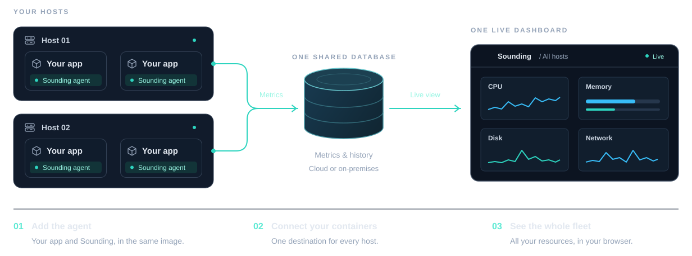

A sounding is how sailors learned what lay beneath the hull: lower a weighted line, or send a ping and listen for
the echo. Sounding brings that same idea to your containers, revealing what's happening beneath the surface.

Sounding shows CPU, memory, disk, network, and GPU activity across your monitored containers and their hosts. Open
a host to compare its containers, then select a container to see which processes are busy now or what changed in
the last 24 hours.

## Where to start

- **Want to see it work first?** [Try the Docker demo](get-started/docker-demo.md). A client calls a web server;
  you follow the traffic without changing your own application.
- **Ready to monitor your application?** [Get your first container reporting](deployment/docker-compose.md).
  Keep your existing application and add Sounding to its image.
- **Running Kubernetes?** [Try the Kubernetes demo](get-started/kubernetes-demo.md), then [set up Sounding on Kubernetes](deployment/kubernetes.md).
- **Want to ask an assistant what's wrong?** [Connect an AI assistant](ai-assistants/connect-an-ai-assistant.md).
  Once Sounding is running, your AI assistant of choice answers from your monitoring data, with evidence.

Not sure which fits, or whether your setup can run Sounding? [Getting started](get-started/getting-started.md) compares
the paths and lists the requirements.

## How it works

1. **You run the Sounding agent in each container you want to monitor.** The launcher starts the agent and
   runs your application with its existing command.
2. **Every agent reports to one PostgreSQL database** that you provide. It can run anywhere your containers can reach.
3. **The dashboard reads that database** and shows every host and container in your browser, updating every second.

There's no sidecar to deploy, and Sounding doesn't need the Docker socket. The agents send monitoring data only to
your database.

Each container you want to monitor needs the agent; adding it to one doesn't automatically monitor the others.
Some host and network details need extra access. See [requirements](get-started/getting-started.md#optional-access).

## What you can see

| Area | What it answers |
|---|---|
| **[CPU](dashboard/investigate-cpu.md)** | Is the container held back by its limit, or competing for the processor? Which process is busy? |
| **[Memory](dashboard/investigate-memory.md)** | How close is it to its limit? Is memory growing? Was anything killed for lack of memory? |
| **[Disk](dashboard/investigate-disk.md)** | Is the disk slow or full? What is filling it? |
| **[Network](dashboard/investigate-network.md)** | Who does the container talk to? Which requests are slow or failing? Which ports are open? |
| **[GPU](dashboard/monitor-gpus.md)** | How busy are the NVIDIA cards, and how much does each container use? |
| **[Events](dashboard/processes-events-and-output.md)** | What happened: restarts, out-of-memory kills, limits reached, new ports and destinations. |

You can look at your whole fleet, one host, or one container, and move between them in a click.

## Supported platforms

| Platform | Start here |
|---|---|
| **Docker Compose** on Linux, or **Docker Desktop** | [Set up Sounding with Docker Compose](deployment/docker-compose.md) |
| **Kubernetes** | [Set up Sounding on Kubernetes](deployment/kubernetes.md) |

Sounding needs **x86-64** Linux containers using **cgroup v2**, and PostgreSQL 14 or later. ARM and Podman aren't
supported yet. See [requirements](get-started/getting-started.md#requirements).

## Next steps

- **Already seeing figures?** [Find your way around the dashboard](dashboard/find-your-way-around.md).
- **Scale across services and machines:** [Monitor containers and hosts](get-started/monitor-containers-and-hosts.md).
- **Prefer to ask a question?** [Connect an AI assistant](ai-assistants/connect-an-ai-assistant.md) to investigate
  the data with read-only tools.
