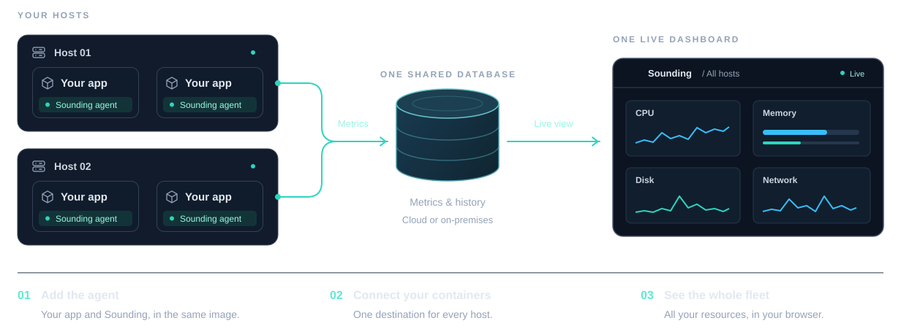

A sounding is how sailors learned what lay beneath the hull: lower a weighted line, or send a ping and listen for the echo. Sounding brings that same idea to your containers, revealing what's happening beneath the surface.

Sounding shows what your Docker containers, and the machines they run on, are doing: CPU, memory, disk, network, and
GPU, live and for the last 24 hours, in one dashboard.

## How it works

1. **You add the Sounding agent to your container image.** It runs inside the same container as your application,
   started by a small launcher in front of your application's own command.
2. **Every agent reports to one PostgreSQL database** that you provide. It can run anywhere your containers can reach.
3. **The dashboard reads that database** and shows every host and container in your browser, updating every second.

There's no sidecar to deploy, Sounding doesn't need the Docker socket, and nothing is sent anywhere except your
database.

## What you can see

| Area | What it answers |
|---|---|
| **CPU** | Is the container held back by its limit, or competing for the processor? Which process is busy? |
| **Memory** | How close is it to its limit? Is memory growing? Was anything killed for lack of memory? |
| **Disk** | Is the disk slow or full? What is filling it? |
| **Network** | Who does the container talk to? Which requests are slow or failing? Which ports are open? |
| **GPU** | How busy are the NVIDIA cards, and how much does each container use? |
| **Events** | What happened: restarts, out-of-memory kills, limits reached, new ports and destinations. |

You can look at your whole fleet, one host, or one container, and move between them in a click.

## Where to start

- **Monitor your application:** [Getting started](get-started/getting-started.md).
- **Scale across services and machines:** [Monitor more containers and hosts](get-started/monitor-more-containers.md).
- **Explore the UI:** [Find your way around the dashboard](dashboard/find-your-way-around.md).
- **No application handy right now?** [Try a standalone demo](get-started/full-demo.md).
