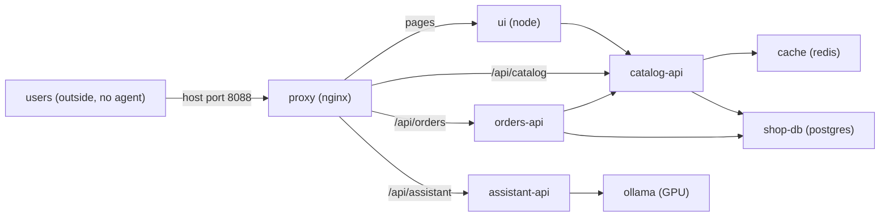

# Technical Documentation

Sounding collects container and host metrics with an in-container agent, stores them in PostgreSQL, and streams
them to a web dashboard. See [product documentation](../product/README.md) for user workflows.

## Stack and versions

| Area | Choice and version |
| --- | --- |
| Agent and dashboard | .NET 11 (SDK 11.0.100); Native AOT agent for Linux x64 and arm64 |
| Dashboard API | ASP.NET Core minimal APIs with built-in OpenAPI; Wolverine 6.64 (`WolverineFx`, mediator-only) for queries and commands |
| Dashboard MCP server | MCP C# SDK 2.4 (`ModelContextProtocol.AspNetCore`), Streamable HTTP, stateless |
| Dashboard frontend | React 19, Tailwind CSS 4 and Vite |
| MCP Inspector (dev tool) | `ghcr.io/modelcontextprotocol/inspector:2.15.0` |
| pgAdmin (dev tool) | `dpage/pgadmin4:9.19`, desktop mode (no sign-in), Sounding's database registered |
| Chat (dev tool) | Open WebUI `ghcr.io/open-webui/open-webui:v0.13.3` with Ollama `ollama/ollama:0.40.16` and `qwen3.5:9b` |
| Database | PostgreSQL 18 |
| Documentation site | Next.js 16 static export; Node.js 24 in Docker |
| Screenshot automation | Playwright 1.56.1 in Docker |

## Services

| Compose file | Services | Local URL |
| --- | --- | --- |
| [Solution](../../docker-compose.yml) | `db`, `dashboard`; `pgadmin`, `mcp-inspector`, `chat`, `chat-model` and `chat-model-pull` in the `tools` profile | Dashboard <http://localhost:8080> (REST `/api/v1`, OpenAPI `/openapi/v1.json`, MCP `/mcp`); pgAdmin <http://localhost:5050> (right-click the `sounding` database, **ERD For Database**, for the schema diagram); Inspector <http://localhost:6274>; Chat <http://localhost:3000> |
| [Samples](../../samples/compose/docker-compose.yml) | A simulated shop platform, every container agent-wrapped (see [below](#samples)) | Dashboard above; shop at <http://localhost:8088> |
| [Kubernetes sample](../../samples/kubernetes/) (manifests, not Compose) | Sounding and a two-service demo on a cluster (see [Kubernetes sample](#kubernetes-sample)) | `kubectl port-forward` |
| [Screenshot capture](../product/screenshots/compose.yaml) | Ephemeral `db`, `dashboard`, `capture` | Internal network only |
| [Documentation site](../product/site/compose.yaml) | One-shot `build`; background `preview` | <http://localhost:4321/sounding/> |

Agents write to PostgreSQL; the dashboard owns its schema and retention (see [Database](architecture.md#database)), reads the database and sends Server-Sent Events to browsers. It also
serves the same data to other applications over REST and to AI agents over MCP; see
[Dashboard API and MCP server](api.md).
These stacks do not configure an OpenTelemetry collector or Aspire dashboard.

### Samples

The samples form a small shop platform that generates realistic traffic between containers; the apps are stubs. Every
container shows something of its own on the dashboard; a container that would only repeat another is left out. The
product documentation's tutorials don't use it: each gives readers one self-contained Compose file to copy.

| Container | What it shows on the dashboard |
| --- | --- |
| `users` | Visitors from outside: no agent and a network of its own; reaches the shop through the host's published port 8088, so the map shows requests arriving at `proxy` from the host. Opens a page, reads an item, places and lists orders every 3 s. Asks the assistant every 30 s only when `SAMPLES_ASSISTANT=1` (`start` sets it with the `gpu` profile); a failed answer, such as a 502 while the model downloads, doubles the delay up to 5 minutes, and a success resets it. |
| `proxy` | Entry point with a published port; HTTP fan-out to `ui` and each API. Resolves upstreams per request, so it starts without the `gpu` profile (assistant requests would then fail with 502, so the simulated users don't send them). |
| `ui` | Server-side rendering: a service calling another (`catalog-api`). |
| `catalog-api` | HTTP, Redis and PostgreSQL requests from one service. |
| `orders-api` | Service-to-service calls (`catalog-api`) and writes. Its "order history" feature (`POST /api/orders/history`, off at start) keeps a receipt of every order in memory (`RECEIPT_KB`, 3 MiB) until the OOM killer stops it at the 512 MiB limit (no swap: `memswap_limit`). The restart switches it off. |
| `cache` | Redis with a memory cap. |
| `shop-db` | PostgreSQL: decoded queries, disk use in the `shop-db` volume. |
| `assistant-api`, `ollama` | `gpu` profile: GPU pages, long requests, an internet destination (model pull). Ollama's context is 4096 tokens so the model fits its 8 GiB limit. |

- The three APIs run one Python image ([samples/compose/api](../../samples/compose/api/api.py)). Proxy and UI configuration lives in
  [samples/compose/platform](../../samples/compose/platform/). Every other sample is built from
  [samples/compose/Dockerfile](../../samples/compose/Dockerfile), which copies the agent into the named base image.
- Compose does not recreate a container when only a `configs` file changes: after editing `samples/compose/platform`, use
  `up -d --force-recreate proxy ui`.

### Kubernetes sample

Plain manifests in [samples/kubernetes](../../samples/kubernetes/), applied with `kubectl apply -f samples/kubernetes/`
after creating the `sounding-db` secret and a `sounding-agent` secret in each namespace. The procedure is the product
[Kubernetes demo](../product/content/get-started/kubernetes-demo.md); the guide for a reader's own workloads is
[Set up Sounding on Kubernetes](../product/content/deployment/kubernetes.md). The documentation site publishes the
folder as `downloads/sounding-kubernetes.zip`, so neither needs a clone.

| File | Contents |
| --- | --- |
| [sounding.yaml](../../samples/kubernetes/sounding.yaml) | `sounding` namespace enforcing the restricted Pod Security Standard (every pod non-root, read-only root filesystem, all capabilities dropped, no service-account token). PostgreSQL StatefulSet (user 70, 5 GiB claim, needs a default StorageClass) with a NetworkPolicy admitting only the dashboard and namespaces labelled `sounding-agents=true`. Dashboard (`dashboard-latest`, `imagePullPolicy: Always`): two replicas spread across nodes with a PodDisruptionBudget, `/readyz` and `/healthz` probes, requests and memory limits, and a NetworkPolicy that admits no pod traffic where the network plugin enforces it (`port-forward` still works). |
| [node-agent.yaml](../../samples/kubernetes/node-agent.yaml) | Optional. `sounding-node` namespace (`pod-security.kubernetes.io/enforce: privileged`, labelled `sounding-agents=true`) and the `node-agent` DaemonSet (root, `SYS_PTRACE`, node `/proc`, `/sys` and `/` read-only). Its own namespace keeps privileged admission away from Sounding's and the application's namespaces. |
| [demo.yaml](../../samples/kubernetes/demo.yaml) | `demo` namespace (labelled `sounding-agents=true`): `web` (nginx, Service) and `client` (busybox calling `http://web/` every 2 s), 2 replicas each, spread one per node with a control-plane toleration and a topology spread constraint, images built from [web](../../samples/kubernetes/web/Dockerfile) and [client](../../samples/kubernetes/client/Dockerfile) with the agent inside. A `sounding-agent` ConfigMap sets `SOUNDING_SAMPLE_HOST=false` and kind's ranges in `SOUNDING_CLUSTER_NETWORKS`. Docker Desktop's kind nodes don't see local images: the demo imports them with `ctr -n k8s.io images import` on each node. |
| [gpu/](../../samples/kubernetes/gpu/node-agent.yaml) | Docker Desktop's NVIDIA GPU: `install-gpu-driver.ps1` copies the WSL driver files Docker injects with `--gpus` to `/opt/wsl-gpu` on each node; `node-agent.yaml` replaces the node agent in `sounding-node` with a privileged one that mounts them and `/dev/dxg` (no device plugin supports WSL). |

Every monitored container in these manifests sets `SOUNDING_HOST_ID` (`spec.nodeName`), `SOUNDING_POD_NAMESPACE`,
`SOUNDING_POD_NAME`, `SOUNDING_POD_UID` (Downward API) and `SOUNDING_POD_CONTAINER`; see
[identity](architecture.md#identity). Kubernetes kills every process of a container on OOM (`memory.oom.group=1`), so
the agent can only report an unexplained restart, with its last memory sample as evidence; see
[the agent's unreported stops](architecture.md#identity).

To run the sample against locally built images, import `famda/sounding:agent-latest` and `dashboard-latest` onto the
nodes as above and apply copies of the manifests with `imagePullPolicy: IfNotPresent`: `Always` would pull the
published images instead.

## Local commands

Use PowerShell and Docker Compose v2 from the repository root. Application builds and documentation generation run
inside containers.

1. Copy [example.env](../../example.env) to `.env` and set `SOUNDING_DB_PASSWORD`.
2. Run `.\platform.ps1 start` to build and start the database, dashboard and samples.
3. Open <http://localhost:8080>.

`start -NoBuild` requires existing images and disables automatic builds. `start -Clean` first removes the dashboard
and sample volumes, permanently deleting their data; the switches can be combined. `start` enables the samples Compose `gpu`
profile (ollama and assistant-api) when `nvidia-smi` lists an NVIDIA GPU on the host; ollama is the only sample with GPU access, so
without it the dashboard reports no GPU. The launcher stops containers from the old `sounding-examples` project before
starting the renamed samples to avoid port conflicts.

`.\platform.ps1 status` lists Sounding containers. `.\platform.ps1 stop` stops dashboard, samples and docs containers,
including the old examples project, preserving volumes. It never stops unrelated Compose projects.
`.\platform.ps1 evals list | run [case] | report | record [case]` checks the MCP tools and prompts against a local model by replaying
recorded scenarios with the database clock held at the moment each was recorded, records every planned attempt, and
compares a run only with the one named by `-Baseline`; `record` records a case in a private copy of the dashboard
and samples. See [evals](../../evals/README.md). It does not need or touch the development stack.
`.\platform.ps1 help` lists all commands.
`setup` and the machine-wide destructive `purge` retain their template behavior.

## Tests

There is no application test stack or `platform-test-runner` service yet. The `test` command and its template options
(`all`, `unit`, `e2e`, `-SlowMo`, `-NoVideo`, `-Keep`, `-NoBuild`) are reserved; they cannot currently run a suite.
The test project name is `sounding-test`, separate from other solutions.

Documentation generation captures documentation screenshots and runs the site build checks: TypeScript compilation,
static export, and generated route/link/anchor/asset/redirect checks. The site has no unit tests for now.
Run `.\platform.ps1 docs generate`; see [site instructions](../product/site/) for build-only verification.

## Publishing

Both workflows run on every push to `main` and can be started by hand; Images also runs when a GitHub release is published.

| Workflow | Publishes |
| --- | --- |
| [Images](../../.github/workflows/images.yml) | `famda/sounding:agent-sha-<short sha>` and `famda/sounding:dashboard-sha-<short sha>` to Docker Hub on every run; a release adds `agent-<version>` and `dashboard-<version>`, and moves `agent-latest` and `dashboard-latest` unless it is a pre-release. linux/amd64 and linux/arm64 (arm64 on native `ubuntu-24.04-arm` runners), with SLSA provenance (`mode=max`), an SBOM, and a keyless cosign signature. Needs the `DOCKERHUB_USERNAME` and `DOCKERHUB_TOKEN` repository secrets. |
| [Documentation pages](../../.github/workflows/pages.yml) | The [documentation site](../product/site/) to <https://famda.github.io/sounding/>. Needs the Pages source set to GitHub Actions. |

### Releasing a version

The agent and dashboard share one version, taken from the release's Git tag; nothing in the repository holds it.
Local builds report `0.0.0-dev` ([Directory.Build.props](../../Directory.Build.props)); the image workflow passes the
version and commit to both Dockerfiles as `VERSION` and `REVISION`, so the binaries' informational version reads
`1.2.0+<commit>`.

1. On GitHub, open **Releases** > **Draft a new release**, type a new tag such as `v1.2.0`, and keep **Target** on `main`.
2. For a pre-release, use a suffixed tag such as `v1.3.0-rc.1` or `v1.3.0-preview.1`. Select **Pre-release** too;
   either one keeps `latest` where it is.
3. Write or generate the release notes and select **Publish release**. The Images workflow builds that commit and
   pushes the version tags. A tag that isn't `v` followed by a semantic version fails the workflow before anything is pushed.

Signatures can be checked with
`cosign verify famda/sounding:agent-1.2.0 --certificate-identity-regexp '^https://github.com/famda/sounding/' --certificate-oidc-issuer https://token.actions.githubusercontent.com`.

## Security model

The dashboard has no built-in authentication, and neither do its REST API (`/api/v1`) and MCP endpoint (`/mcp`): anyone
who reaches port 8080 can read everything and request packet captures over REST. MCP tools are read-only. Keep the
samples and dashboard private; the docs preview, pgAdmin and MCP Inspector bind only to loopback. On Kubernetes the
[sample's NetworkPolicy](../../samples/kubernetes/sounding.yaml) stands in for loopback binding where the network plugin enforces it. Store local settings in the
untracked `.env` file.

## Documents

- [Dashboard API and MCP server](api.md)
- [Documentation generation, preview and publishing](../product/site/)
