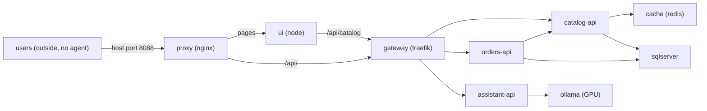

# Technical Documentation

Sounding collects container and host metrics with an in-container agent, stores them in PostgreSQL, and streams
them to a web dashboard. See [product documentation](../product/README.md) for user workflows.

## Stack and versions

| Area | Choice and version |
| --- | --- |
| Agent and dashboard | .NET 11 (SDK 11.0.100); Native AOT agent for Linux x64 |
| Dashboard frontend | React 19, Tailwind CSS 4 and Vite |
| Database | PostgreSQL 18 |
| Documentation site | Next.js 16 static export; Node.js 24 in Docker |
| Screenshot automation | Playwright 1.56.1 in Docker |

## Services

| Compose file | Services | Local URL |
| --- | --- | --- |
| [Solution](../../docker-compose.yml) | `db`, `dashboard` | <http://localhost:8080> |
| [Samples](../../samples/docker-compose.yml) | A simulated shop platform, every container agent-wrapped (see [below](#samples)) | Dashboard above; shop at <http://localhost:8088> |
| [Screenshot capture](../product/screenshots/compose.yaml) | Ephemeral `db`, `dashboard`, `capture` | Internal network only |
| [Documentation site](../product/site/compose.yaml) | One-shot `build`; background `preview` | <http://localhost:4321/sounding/> |

Agents write to PostgreSQL; the dashboard reads the database and sends Server-Sent Events to browsers.
These stacks do not configure an OpenTelemetry collector or Aspire dashboard.

### Samples

The samples form a small shop platform that generates realistic traffic between containers; the apps are stubs.

- `users` (curl) opens the shop page, reads an item, places and lists orders every 3 s, and asks the assistant every
  30 s. It stands for visitors: it has no agent and a network of its own, and reaches the shop through the host's
  published port 8088, so the map shows its requests arriving at `proxy` from the host.
- The three APIs run one Python image ([samples/api](../../samples/api/api.py)): `catalog-api` reads items from SQL
  Server through a 20 s Redis cache, `orders-api` checks the item with `catalog-api` and writes to SQL Server, and
  `assistant-api` generates a short answer with `gemma3:270m`, which it pulls into the `ollama-models` volume on start.
- Proxy, gateway and UI configuration lives in [samples/platform](../../samples/platform/). Every other sample is
  built from [samples/Dockerfile](../../samples/Dockerfile), which copies the agent into the named base image.
- `ollama` and `assistant-api` are in the `gpu` profile; without them, assistant requests fail with 502 at the gateway.

## Local commands

Use PowerShell and Docker Compose v2 from the repository root. Application builds and documentation generation run
inside containers.

1. Copy [example.env](../../example.env) to `.env` and set `SOUNDING_DB_PASSWORD`.
2. Run `.\platform.ps1 start` to build and start the database, dashboard and samples.
3. Open <http://localhost:8080>.

`start -NoBuild` requires existing images and disables automatic builds. `start -Clean` first removes the dashboard
and sample volumes, permanently deleting their data; the switches can be combined. `start` enables the samples Compose `gpu`
profile (ollama and assistant-api) when `nvidia-smi` lists an NVIDIA GPU on the host; ollama is the only sample with GPU access, so
without it the dashboard reports no GPU. The launcher stops containers from the old `sounding-examples` project before
starting the renamed samples to avoid port conflicts.

`.\platform.ps1 status` lists Sounding containers. `.\platform.ps1 stop` stops dashboard, samples and docs containers,
including the old examples project, preserving volumes. It never stops unrelated Compose projects.
`.\platform.ps1 help` lists all commands.
`setup` and the machine-wide destructive `purge` retain their template behavior.

## Tests

There is no application test stack or `platform-test-runner` service yet. The `test` command and its template options
(`all`, `unit`, `e2e`, `-SlowMo`, `-NoVideo`, `-Keep`, `-NoBuild`) are reserved; they cannot currently run a suite.
The test project name is `sounding-test`, separate from other solutions.

Documentation generation captures documentation screenshots and runs the site build checks:
Markdown transformation tests, TypeScript compilation, static export, and generated route/link/anchor/asset checks.
Run `.\platform.ps1 docs generate`; see [site instructions](../product/site/README.md) for build-only verification.

## Publishing

Both workflows run on every push to `main` and can be started by hand.

| Workflow | Publishes |
| --- | --- |
| [Images](../../.github/workflows/images.yml) | `famda/sounding:agent-<short sha>` and `famda/sounding:dashboard-<short sha>` to Docker Hub, plus `agent-latest` and `dashboard-latest` from `main` only. Needs the `DOCKERHUB_USERNAME` and `DOCKERHUB_TOKEN` repository secrets. linux/amd64 only. |
| [Documentation pages](../../.github/workflows/pages.yml) | The [documentation site](../product/site/README.md#publish) to <https://famda.github.io/sounding/>. Needs the Pages source set to GitHub Actions. |

## Security model

The dashboard has no built-in authentication. Keep the samples and dashboard private; the docs preview binds only to
loopback. Store local settings in the untracked `.env` file.

## Documents

- [Documentation generation, preview and publishing](../product/site/README.md)
